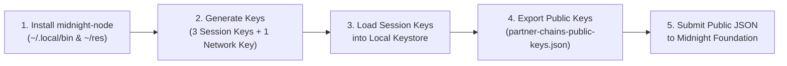

# Midnight Node & Validator Key Setup Guide (Preprod)

> **Setup Order — Step 2 of 4** | [← Step 1: Cardano Node](./running-cardano-node.md) · [Overview](./README.md) · **Next:** [Step 3: WireGuard Overlay](./wireguard.md) →  
> **Document Scope:** Midnight Network — Federated Node Operator (FNO) Onboarding (Preprod)  
> **Source Reference:** `midnightntwrk/midnight-network-ops` (`docs/fno-guides/preprod/install-node-and-keys.md`, commit `25d2d3c`, synced `2026-09-15`)

This guide walks you through installing the **Midnight Node** (`midnight-node`) binary on the **Preprod** testnet, generating the cryptographic keys required to operate as a **Federated Node Operator (FNO) / Validator**, and producing the public-key registration file needed for onboarding.

> [!NOTE]
> **New to Midnight? Here is the high-level context:**
> - **Midnight** is a Substrate-based partner chain connected to **Cardano**.
> - **Preprod** is Midnight's pre-production test network (`NETWORK=preprod`). The steps here are identical to Mainnet except where noted.
> - **Federated Node Operator (FNO) / Validator:** A node authorized to produce and finalize blocks on the Midnight network. To become one, you generate cryptographic keys locally, keep the private keys secret on your server, and submit **only the public keys** (`partner-chains-public-keys.json`) to the Midnight Foundation.
> - **Non-validator (relay/RPC) nodes** only need Section 1 (and optionally Section 2.2 for a persistent P2P identity); they do **not** need validator session keys.

---

## Table of Contents

- [Workflow Overview](#workflow-overview)
- [Before You Begin](#before-you-begin)
- [1. Install the Midnight Node](#1-install-the-midnight-node)
  - [1.1 Prepare the Service User and Directories](#11-prepare-the-service-user-and-directories)
  - [1.2 Download and Install the Binary](#12-download-and-install-the-binary)
- [2. Manage Validator Keys](#2-manage-validator-keys)
  - [Key Types and Roles](#key-types-and-roles)
  - [2.1 Generate Session Keys](#21-generate-session-keys)
  - [2.2 Generate the Network Key](#22-generate-the-network-key)
- [3. Configure the Keystore](#3-configure-the-keystore)
- [4. Register as a Federated Node Operator](#4-register-as-a-federated-node-operator)
  - [4.1 Create the Registration File](#41-create-the-registration-file)
  - [4.2 Verify the Output](#42-verify-the-output)
- [5. Secret Management Best Practices](#5-secret-management-best-practices)
- [File & Key Sensitivity Summary](#file--key-sensitivity-summary)

---

## Workflow Overview



---

## Before You Begin

- **OS:** Linux (`linux-amd64`), with `sudo` access to create the service user and install `jq`.
- **Target Version:** `midnight-node` `node-0.22.2` *(always verify the latest release tag in the official [Midnight Node repository](https://github.com/midnightntwrk/midnight-node/releases))*.
- **Service User:** All commands run as a dedicated non-root user named `midnight` (`/home/midnight`).
- **Directory Layout:**
  - `~/.local/bin/` — Executable binaries (`midnight-node`)
  - `~/data/` — Node database, P2P network key, and validator keystore
  - `~/res/` — Chain specification and resource files bundled with the release

---

## 1. Install the Midnight Node

### 1.1 Prepare the Service User and Directories

Run the entire Preprod setup as a dedicated non-root `midnight` user. Create it if it does not exist, then switch to that user:

```bash
sudo adduser --disabled-password --gecos "" midnight
sudo usermod -aG sudo midnight
sudo su - midnight
```

Create the directory structure and add `~/.local/bin` to your `PATH` so the `midnight-node` binary resolves from anywhere:

```bash
mkdir -p ~/data ~/res ~/.local/bin
echo 'export PATH="$HOME/.local/bin:$PATH"' >> ~/.bashrc
source ~/.bashrc
```

### 1.2 Download and Install the Binary

Always verify the latest release tag from the official Midnight Node repository before downloading.

1. Download and extract the release archive:

   ```bash
   mkdir -p ~/tmp && cd ~/tmp
   curl -L -O https://github.com/midnightntwrk/midnight-node/releases/download/node-2.1.101/midnight-node-2.1.101-linux-amd64.tar.gz
   tar -xvzf midnight-node-2.1.101-linux-amd64.tar.gz
   ```

2. Move the binary and resource files to their permanent locations:

   ```bash
   mv ~/tmp/midnight-node ~/.local/bin/
   mv ~/tmp/res ~/
   ```

3. Confirm the binary is executable and on your `PATH`:

   ```bash
   midnight-node --version
   ```

---

## 2. Manage Validator Keys

> [!WARNING]
> **Critical Security Notice:** These keys grant control over your node's network identity, block production, finality voting, and Cardano cross-chain operations. Compromising these private keys can lead to loss of control over your validator. Never share the generated key files or commit them to Git.

### Key Types and Roles

A Midnight validator uses four distinct cryptographic keys:

| Key Name | Crypto Scheme | Key Type | Purpose |
| :--- | :--- | :--- | :--- |
| **Node Key** | `ed25519` | Network | Persistent P2P network identity (`PeerID`) used to identify your node to peers. |
| **Aura Key** | `sr25519` | `aura` | **Block production** — signs newly proposed Midnight blocks. |
| **Grandpa Key** | `ed25519` | `gran` | **Block finality** — votes to finalize blocks on the irreversible chain. |
| **Cross-Chain Key** | `ecdsa` | `beef` | **Cardano bridge** — signs cross-chain interactions with the Cardano parent chain. |

> [!NOTE]
> Key generation is **only required if you are running a validator (block producer)**. Non-validator  nodes do not need session keys.

### 2.1 Generate Session Keys

Generate the three validator session keys in JSON format (each JSON file contains a `secretPhrase`, `secretSeed`, and `publicKey`):

```bash
cd ~

# Generate AURA (sr25519) — block production
midnight-node key generate --scheme sr25519 --output-type json > aura.json

# Generate GRANDPA (ed25519) — block finality
midnight-node key generate --scheme ed25519 --output-type json > grandpa.json

# Generate CROSS-CHAIN (ecdsa) — Cardano parent-chain bridging
midnight-node key generate --scheme ecdsa --output-type json > cross_chain.json
```

> [!IMPORTANT]
> **Back up `aura.json`, `grandpa.json`, and `cross_chain.json` immediately** in a secure, offline location (e.g., an encrypted password manager or hardware-backed vault). If these files are lost, you cannot recover the validator identity.

### 2.2 Generate the Network Key

The network key gives your node a persistent `PeerID` on the P2P layer (similar to an SSH host key). Store it inside the chain's `network/` directory with restricted permissions (`700`):

```bash
NETWORK="preprod"
NETWORK_DIR="$HOME/data/chains/midnight_${NETWORK}/network"
mkdir -p "$NETWORK_DIR"
chmod 700 "$NETWORK_DIR"

midnight-node key generate-node-key --file "$NETWORK_DIR/secret_ed25519"
```

View your node's unique `PeerID` (safe to share when configuring bootnodes/peers):

```bash
midnight-node key inspect-node-key --file "$NETWORK_DIR/secret_ed25519"
```

---

## 3. Configure the Keystore

The **keystore** is the directory where `midnight-node` reads your validator's signing keys at runtime. Install `jq` to parse the secret phrases from your JSON files and insert all three session keys into the keystore:

```bash
sudo apt-get install jq -y

KEYSTORE_PATH="$HOME/data/chains/midnight_preprod/keystore"
mkdir -p "$KEYSTORE_PATH"

# Insert AURA key (block production)
midnight-node key insert \
  --keystore-path "$KEYSTORE_PATH" \
  --scheme sr25519 \
  --key-type aura \
  --suri "$(jq -r .secretPhrase aura.json)"

# Insert GRANDPA key (finality)
midnight-node key insert \
  --keystore-path "$KEYSTORE_PATH" \
  --scheme ed25519 \
  --key-type gran \
  --suri "$(jq -r .secretPhrase grandpa.json)"

# Insert Cross-Chain key (Cardano bridge)
midnight-node key insert \
  --keystore-path "$KEYSTORE_PATH" \
  --scheme ecdsa \
  --key-type beef \
  --suri "$(jq -r .secretPhrase cross_chain.json)"
```

> [!NOTE]
> **Production Key Loading:** By default, `midnight-node` loads keys from `$HOME/data/chains/midnight_preprod/keystore`. For production hardening, the recommended pattern is to keep seed files **outside** the node data directory and inject them via environment variables (`AURA_SEED_FILE`, `GRANDPA_SEED_FILE`, `CROSS_CHAIN_SEED_FILE`).

---

## 4. Register as a Federated Node Operator

To be added to the Preprod validator set, extract **only the public keys** into a single registration JSON file.

### 4.1 Create the Registration File

```bash
OUTPUT_FILE="$HOME/partner-chains-public-keys.json"

cat <<EOF > "$OUTPUT_FILE"
{
  "partner_chains_key": "$(jq -r .publicKey cross_chain.json)",
  "keys": {
    "aura": "$(jq -r .publicKey aura.json)",
    "crch": "$(jq -r .publicKey cross_chain.json)",
    "gran": "$(jq -r .publicKey grandpa.json)"
  }
}
EOF
```

### 4.2 Verify the Output

Inspect the file to confirm all four public key fields are populated:

```bash
cat "$OUTPUT_FILE"
```

## File & Key Sensitivity Summary

| File / Directory | Contains | Sensitivity | Action |
| :--- | :--- | :--- | :--- |
| `~/aura.json`, `~/grandpa.json`, `~/cross_chain.json` | Private key seeds & phrases | **SECRET** | Back up offline, `chmod 600`, never share |
| `~/data/chains/midnight_preprod/network/secret_ed25519` | P2P private network key | **SECRET** | Keep on host, `chmod 600`, never share |
| `~/data/chains/midnight_preprod/keystore/` | Imported session signing keys | **SECRET** | Restrict access to `midnight` user only |
| `~/partner-chains-public-keys.json` | Public keys only | **PUBLIC** | Share with Midnight Foundation to register |

---

**Navigation:** [← Step 1: Cardano Node](./running-cardano-node.md) · [Overview](./README.md) · **Next:** [Step 3: WireGuard Overlay →](./wireguard.md)
