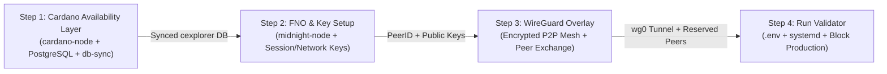

# Midnight Preprod Validator — End-to-End Setup Guide

Welcome to the **Midnight Preprod Federated Node Operator (FNO)** documentation. Follow the four guides in this directory **strictly in order**, as each stage produces artifacts (synced databases, cryptographic keys, and network tunnels) required by the next.

---

## System Requirements

Before starting Step 1, ensure your host meets the following minimum hardware specifications:

| Resource | Requirement | Notes |
| :--- | :--- | :--- |
| **CPU** | **8 vCPU** | Handles concurrent `cardano-node`, `cardano-db-sync`, PostgreSQL, and `midnight-node` workloads |
| **Memory (RAM)** | **16–32 GB RAM** | 32 GB recommended for smooth PostgreSQL caching and `cardano-db-sync` indexing |
| **Storage** | **Minimum 500 GB SSD** | **Do not provision less than 500 GB** — smaller disks risk exhausting storage across Cardano chain data, `cexplorer` DB, and Midnight node state |

---

## Setup Sequence Overview

---

## Step-by-Step Guide Index

| Step | Guide | What You Will Set Up | Key Outputs / Gate Before Next Step |
| :--- | :--- | :--- | :--- |
| **Step 1** | **[Running Cardano Node](./running-cardano-node.md)** | `cardano-node` (via Mithril snapshot), PostgreSQL 17 (`cexplorer` DB), and `cardano-db-sync` | `cardano-node` and `cardano-db-sync` are active; `sync_percent` is near `100%` |
| **Step 2** | **[FNO Setup (Midnight Node & Keys)](./FNOSetup.md)** | `midnight` user, `midnight-node` binary, AURA/GRANDPA/Cross-Chain session keys, Substrate network key (`secret_ed25519`), and keystore | `partner-chains-public-keys.json` generated and submitted to Midnight Foundation |
| **Step 3** | **[WireGuard Overlay Setup](./wireguard.md)** | WireGuard `v1.0.20250521`, WireGuard tunnel keypair, `/etc/wireguard/wg0.conf`, and Foundation peer exchange | `wg show` displays recent handshakes and non-zero data transfer; overlay IPs pingable |
| **Step 4** | **[Running the Validator](./running%20validator.md)** | `~/.env` configuration, interactive test launch, `midnight-node` `systemd` service, and `n+2` epoch block-production verification | `midnight-node.service` is `active (running)` and authoring/finalizing blocks |

---

## Recommended Reading Order

1. Start with **[Step 1: Running Cardano Node](./running-cardano-node.md)** (note: `cardano-db-sync` takes ~6–7 hours to index Preprod, so start this first).
2. While or after `cardano-db-sync` finishes, complete **[Step 2: FNO Setup](./FNOSetup.md)** to install `midnight-node` and generate your validator keys.
3. Proceed to **[Step 3: WireGuard Overlay Setup](./wireguard.md)** using the `PeerID` generated in Step 2 to join the trusted validator mesh.
4. Finish with **[Step 4: Running the Validator](./running%20validator.md)** to launch `midnight-node` in `--validator` mode and confirm block production.
