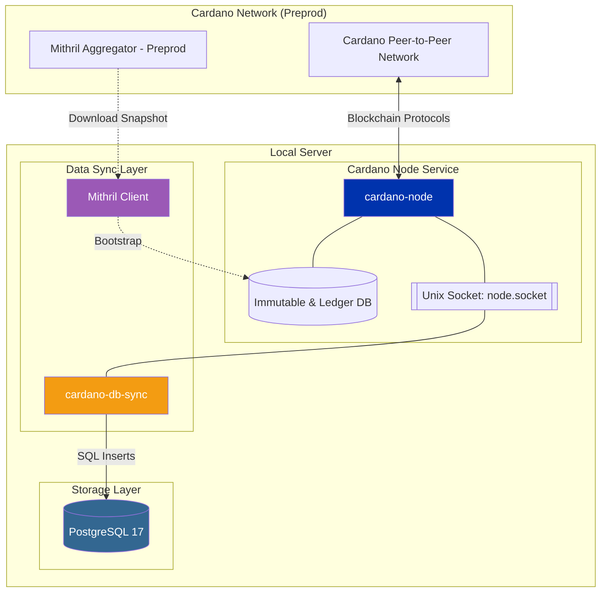

# Cardano Availability Layer Setup Guide (Preprod)

> **Setup Order — Step 1 of 4** | [Overview](./README.md) · **Next:** [Step 2: FNO Setup (Midnight Node & Keys)](./Validator%20key%20genration.md) →  
> **Document Scope:** Midnight Network Preprod Track  
> **Source Reference:** `midnightntwrk/midnight-network-ops` (`cardano-node.md`, `postgresql.md`, `cardano-db-sync.md` — commit `25d2d3c`, synced `2026-09-15`)

This guide walks you through setting up the three Cardano components required to run a Midnight validator on the **Preprod** testnet. Complete these parts in order:

1. **Cardano Relay Node (`cardano-node`)** — Connects to the Cardano Preprod network and maintains a local copy of the blockchain (fast-bootstrapped with Mithril).
2. **PostgreSQL 17** — Stores indexed blockchain data for querying.
3. **Cardano DB Sync (`cardano-db-sync`)** — Reads blocks from `cardano-node` and writes them into PostgreSQL.

> [!NOTE]
> **Preprod vs. Mainnet:** Preprod uses a different Mithril endpoint, smaller databases, and testnet chain configs (`--testnet-magic 1`), requiring less hardware than Mainnet. However, `cardano-db-sync` does not have Preprod snapshots available, so initial database indexing takes approximately **6–7 hours** depending on your machine's disk IOPS.

---

## Table of Contents

- [Architecture Overview](#architecture-overview)
- [Before You Begin](#before-you-begin)
- [Part 1: Set Up the Cardano Relay Node](#part-1-set-up-the-cardano-relay-node)
  - [1.1 Download the Blockchain Snapshot via Mithril](#11-download-the-blockchain-snapshot-via-mithril)
  - [1.2 Install and Configure `cardano-node`](#12-install-and-configure-cardano-node)
- [Part 2: Install & Configure PostgreSQL](#part-2-install--configure-postgresql)
  - [2.1 Install PostgreSQL 17](#21-install-postgresql-17)
  - [2.2 Create the Database & User](#22-create-the-database--user)
  - [2.3 Configure Passwordless Authentication (`.pgpass`)](#23-configure-passwordless-authentication-pgpass)
  - [2.4 Performance Tuning](#24-performance-tuning)
- [Part 3: Set Up `cardano-db-sync`](#part-3-set-up-cardano-db-sync)
  - [3.1 Install Binaries, Schema, and Config](#31-install-binaries-schema-and-config)
  - [3.2 Configure & Start the `cardano-db-sync` Service](#32-configure--start-the-cardano-db-sync-service)
  - [3.3 Verify Synchronization](#33-verify-synchronization)

---

## Architecture Overview



---

## Before You Begin

- **Service User:** All steps assume you are logged in as the dedicated `midnight` user (home directory `/home/midnight`) with `sudo` privileges. If you use a different username, update all `/home/midnight` paths accordingly.
- **Target Versions:**
  - `cardano-node`: `11.1.3` *(used during this deployment — verify against your Mithril snapshot)*
  - `PostgreSQL`: `17`
  - `cardano-db-sync`: `13.7.1.0`
- **Directory Layout:**
  - `~/.local/bin/` — `cardano-node`, `cardano-cli`, and `cardano-db-sync` executables
  - `~/.local/share/preprod/` — Network configs (`config.json`, `topology.json`, etc.)
  - `~/cardano-data/` — Blockchain DB (`db/`), Unix socket (`db/node.socket`), `db-sync-config.json`, `schema/`, and `db-sync-state/`
  - `~/.pgpass` — Database credentials file

---

## Part 1: Set Up the Cardano Relay Node

Instead of syncing the blockchain from block zero (which takes a long time), you will download a verified Mithril snapshot and then let `cardano-node` catch up to the live tip.

> [!IMPORTANT]
> After downloading the Mithril snapshot, check the **`cardano-node` version** printed in the terminal output for that snapshot. You **must** download and use that exact `cardano-node` version — using a different version will cause `cardano-node` to ignore the snapshot and resync from block zero.

### 1.1 Download the Blockchain Snapshot via Mithril

#### Step 1: Install the Mithril Client

Create a temporary working folder and download `mithril-client`:

```bash
mkdir -p $HOME/tmp/mithril && cd $HOME/tmp/mithril

curl --proto '=https' --tlsv1.2 -sSf https://raw.githubusercontent.com/input-output-hk/mithril/refs/heads/main/mithril-install.sh | sh -s -- -c mithril-client -d unstable -p $(pwd)
```

#### Step 2: Set Preprod Environment Variables

These variables tell the Mithril client which network, aggregator, and verification keys to use. (Refer to the Mithril Network Documentation if you ever need updated keys or endpoints.)

```bash
export CARDANO_NETWORK=preprod
export AGGREGATOR_ENDPOINT=https://aggregator.release-preprod.api.mithril.network/aggregator
export GENESIS_VERIFICATION_KEY=$(curl -sSf https://raw.githubusercontent.com/input-output-hk/mithril/main/mithril-infra/configuration/release-preprod/genesis.vkey)
export ANCILLARY_VERIFICATION_KEY=$(curl -sSf https://raw.githubusercontent.com/input-output-hk/mithril/main/mithril-infra/configuration/release-preprod/ancillary.vkey)
export SNAPSHOT_DIGEST=latest
```

#### Step 3: Download and Verify the Snapshot

Inspect the latest available snapshot and download it (this creates a `db/` directory inside `~/tmp/mithril`):

```bash
# List available snapshots
./mithril-client cardano-db snapshot list

# View details of the latest snapshot
./mithril-client cardano-db snapshot show $SNAPSHOT_DIGEST

# Download the snapshot
./mithril-client cardano-db download --include-ancillary $SNAPSHOT_DIGEST
```

### 1.2 Install and Configure `cardano-node`

> [!NOTE]
> Set `VERSION` below to match the `cardano-node` version indicated by the Mithril snapshot output in the previous step (`11.1.3` is used here as the reference version).

#### Step 1: Download Binaries & Config Files

Extract `cardano-node` binaries into `~/.local/bin` and network configs into `~/.local/share`:

```bash
mkdir -p ~/.local/bin ~/.local/share ~/tmp

VERSION="11.1.3"
ARCH="linux-amd64"
URL="https://github.com/IntersectMBO/cardano-node/releases/download/${VERSION}/cardano-node-${VERSION}-${ARCH}.tar.gz"

curl -L "$URL" -o ~/tmp/cardano-node.tar.gz
tar -xz -C ~/.local/bin   --strip-components=2 -f ~/tmp/cardano-node.tar.gz ./bin
tar -xz -C ~/.local/share --strip-components=1 -f ~/tmp/cardano-node.tar.gz ./share
chmod +x ~/.local/bin/cardano-*
```

Add `~/.local/bin` to your `PATH` and verify the installation:

```bash
echo 'export PATH="$HOME/.local/bin:$PATH"' >> ~/.bashrc
source ~/.bashrc

cardano-node --version
```

#### Step 2: Move the Snapshot into Place

```bash
mkdir -p ~/cardano-data
mv ~/tmp/mithril/db/ ~/cardano-data/
```

#### Step 3: Run a Quick Manual Test

Before turning this into a background service, start the node manually once to verify the snapshot loads cleanly and reaches the chain tip:

```bash
cardano-node run \
    --topology $HOME/.local/share/preprod/topology.json \
    --database-path $HOME/cardano-data/db \
    --socket-path $HOME/cardano-data/db/node.socket \
    --host-addr 0.0.0.0 \
    --port 3001 \
    --config $HOME/.local/share/preprod/config.json
```

Open a second terminal and query the node tip (`--testnet-magic 1` is for Preprod):

```bash
export CARDANO_NODE_SOCKET_PATH="$HOME/cardano-data/db/node.socket"
cardano-cli query tip --testnet-magic 1
```

- **What to look for:** A `syncProgress` value near `100.00`.
- Once confirmed, return to the first terminal and stop the manual node with `Ctrl + C`.

#### Step 4: Configure & Start the Systemd Service

Create `/etc/systemd/system/cardano-node.service`:

```bash
sudo nano /etc/systemd/system/cardano-node.service
```

Paste the following configuration:

```ini
[Unit]
Description=Cardano Relay Node (Preprod)
Wants=network-online.target
After=network-online.target

[Service]
User=midnight
Type=simple
WorkingDirectory=/home/midnight/cardano-data
ExecStart=/home/midnight/.local/bin/cardano-node run \
    --topology /home/midnight/.local/share/preprod/topology.json \
    --database-path /home/midnight/cardano-data/db \
    --socket-path /home/midnight/cardano-data/db/node.socket \
    --host-addr 0.0.0.0 \
    --port 3001 \
    --config /home/midnight/.local/share/preprod/config.json
KillSignal=SIGINT
Restart=always
RestartSec=5
LimitNOFILE=32768

[Install]
WantedBy=multi-user.target
```

Enable and start the service:

```bash
sudo systemctl daemon-reload
sudo systemctl enable cardano-node
sudo systemctl start cardano-node
```

---

## Part 2: Install & Configure PostgreSQL

`cardano-db-sync` requires PostgreSQL to store indexed chain state.

### 2.1 Install PostgreSQL 17

Add the official PostgreSQL APT repository and install PostgreSQL 17:

```bash
sudo apt install curl ca-certificates -y
sudo install -d /usr/share/postgresql-common/pgdg
sudo curl -s -o /usr/share/postgresql-common/pgdg/apt.postgresql.org.asc --fail https://www.postgresql.org/media/keys/ACCC4CF8.asc
sudo sh -c 'echo "deb [signed-by=/usr/share/postgresql-common/pgdg/apt.postgresql.org.asc] https://apt.postgresql.org/pub/repos/apt $(lsb_release -cs)-pgdg main" > /etc/apt/sources.list.d/pgdg.list'
sudo apt update && sudo apt -y install postgresql-17 postgresql-server-dev-17
```

Verify the installed version and cluster name:

```bash
psql --version
pg_lsclusters
```

> [!NOTE]
> Every path below assumes major version `17` (`/etc/postgresql/17/main/...`). If `pg_lsclusters` shows a different version, substitute that number in the paths below.

### 2.2 Create the Database & User

Open the PostgreSQL shell as the `postgres` superuser:

```bash
sudo -u postgres psql
```

Run the following SQL commands (replace `'your_secure_password'` with a strong password):

```sql
CREATE USER midnight WITH PASSWORD 'your_secure_password';
ALTER ROLE midnight WITH SUPERUSER CREATEDB;
CREATE DATABASE cexplorer;
\q
```

### 2.3 Configure Passwordless Authentication (`.pgpass`)

Create `~/.pgpass` so `cardano-db-sync`, `midnight-node`, and `psql` can authenticate automatically without prompting for a password:

```bash
export POSTGRES_PASSWORD='your_secure_password'
export PGPASSFILE="${HOME}/.pgpass"

# Entry 1: Unix socket (used by cardano-db-sync)
echo "/var/run/postgresql:5432:cexplorer:midnight:$POSTGRES_PASSWORD" > "$PGPASSFILE"

# Entry 2: Localhost TCP (used by midnight-node and `psql -h localhost`)
echo "localhost:5432:cexplorer:midnight:$POSTGRES_PASSWORD" >> "$PGPASSFILE"

chmod 0600 "$PGPASSFILE"
```

> [!TIP]
> **Using a different PostgreSQL username?** If your PostgreSQL user differs from your Linux user, peer authentication over the Unix socket will not match — connections will use TCP on `127.0.0.1` instead. In that case, add an entry for `127.0.0.1` at the top of `~/.pgpass`:
>
> ```text
> 127.0.0.1:5432:cexplorer:<username>:your_secure_password
> ```

### 2.4 Performance Tuning

Edit `/etc/postgresql/17/main/postgresql.conf`:

```bash
sudo nano /etc/postgresql/17/main/postgresql.conf
```

Set the following parameters to speed up indexing and queries:

| Parameter                          | Recommended Value | Purpose                                                        |
| :--------------------------------- | :---------------- | :------------------------------------------------------------- |
| `shared_buffers`                   | `4GB`             | Keeps active ledger data in memory.                            |
| `maintenance_work_mem`             | `1GB`             | Speeds up index creation during sync.                          |
| `max_parallel_maintenance_workers` | `2`               | Uses multiple CPU cores when building indexes.                 |
| `effective_cache_size`             | `12GB`            | Tells the query planner how much RAM is available for caching. |
| `join_collapse_limit`              | `1`               | Forces PostgreSQL to follow the exact SQL join order.          |

Restart PostgreSQL after saving your changes so they take effect before starting `cardano-db-sync`:

```bash
sudo systemctl restart postgresql
```

---

## Part 3: Set Up `cardano-db-sync`

`cardano-db-sync` connects to your running `cardano-node` socket (Part 1) and populates your PostgreSQL database (Part 2).

### 3.1 Install Binaries, Schema, and Config

#### Step 1: Download & Extract `cardano-db-sync` (`13.7.1.0`)

```bash
NETWORK="preprod"
mkdir -p ~/tmp && cd ~/tmp
curl -L -O https://github.com/IntersectMBO/cardano-db-sync/releases/download/13.7.1.0/cardano-db-sync-13.7.1.0-linux.tar.gz
tar -xzf cardano-db-sync-13.7.1.0-linux.tar.gz
```

#### Step 2: Install Binaries & Database Schema

```bash
cp bin/* ~/.local/bin/
mkdir -p ~/cardano-data/
sudo mv ~/tmp/schema ~/cardano-data/
```

#### Step 3: Download & Update `db-sync-config.json`

Download the Preprod DB Sync config and point its `NodeConfigFile` setting to your local `cardano-node` config:

```bash
cd ~/cardano-data
curl -O https://book.world.dev.cardano.org/environments/$NETWORK/db-sync-config.json
sed -i "s|\"NodeConfigFile\": \"config.json\"|\"NodeConfigFile\": \"/home/midnight/.local/share/$NETWORK/config.json\"|" ~/cardano-data/db-sync-config.json
```

### 3.2 Configure & Start the `cardano-db-sync` Service

Create `/etc/systemd/system/cardano-db-sync.service`:

```bash
sudo nano /etc/systemd/system/cardano-db-sync.service
```

Paste the following configuration:

```ini
[Unit]
Description=Cardano DB Sync (Preprod)
After=cardano-node.service
Requires=cardano-node.service

[Service]
User=midnight
Type=simple
Environment="PGPASSFILE=/home/midnight/.pgpass"
WorkingDirectory=/home/midnight/cardano-data
ExecStart=/home/midnight/.local/bin/cardano-db-sync \
    --config /home/midnight/cardano-data/db-sync-config.json \
    --socket-path /home/midnight/cardano-data/db/node.socket \
    --schema-dir /home/midnight/cardano-data/schema \
    --state-dir /home/midnight/cardano-data/db-sync-state
KillSignal=SIGINT
Restart=always
RestartSec=10
LimitNOFILE=32768

[Install]
WantedBy=multi-user.target
```

Enable, start, and monitor the logs:

```bash
sudo systemctl daemon-reload
sudo systemctl enable cardano-db-sync
sudo systemctl start cardano-db-sync

# Tail logs to confirm it is running properly
sudo journalctl -fu cardano-db-sync.service --no-pager -n 50
```

- **Healthy output:** Shows a successful connection to PostgreSQL and active block insertion.
- **If it crashes or loops on connection errors:** Verify PostgreSQL is running and check that `PGPASSFILE` points to `/home/midnight/.pgpass` with matching credentials. (For sync failures or rollbacks, see *Runbook 01 · DB Sync Failure*; for node issues, see *Runbook 08 · Cardano Node Sync Failure*.)

### 3.3 Verify Synchronization

#### Option A: One-Off Status Checks

Check the latest synced block in PostgreSQL:

```bash
psql -d cexplorer -c "SELECT block_no, slot_no, time FROM block ORDER BY id DESC LIMIT 1;"
```

Check the current sync percentage:

```bash
psql -d cexplorer -c "
SELECT
    100 * (EXTRACT(epoch FROM (MAX(time) AT TIME ZONE 'UTC')) - EXTRACT(epoch FROM (MIN(time) AT TIME ZONE 'UTC')))
    / (EXTRACT(epoch FROM (NOW() AT TIME ZONE 'UTC')) - EXTRACT(epoch FROM (MIN(time) AT TIME ZONE 'UTC')))
AS sync_percent
FROM block;"
```

#### Option B: Live Tracking Dashboard (Recommended)

Refreshes every 10 seconds to show current block height, sync percentage, and time lag behind real time:

```bash
watch -n 10 "psql -h 127.0.0.1 -U midnight -d cexplorer -c \"
SELECT
    max(block_no) AS max_db_block,
    ROUND((100 * (EXTRACT(epoch FROM (MAX(time) AT TIME ZONE 'UTC')) - EXTRACT(epoch FROM (MIN(time) AT TIME ZONE 'UTC')))) / (EXTRACT(epoch FROM (NOW() AT TIME ZONE 'UTC')) - EXTRACT(epoch FROM (MIN(time) AT TIME ZONE 'UTC'))), 2) AS sync_percent,
    NOW() AT TIME ZONE 'UTC' - max(time) AS live_gap
FROM block;\""
```

- **When is it ready?** When `sync_percent` is near `100` and `live_gap` is only a few seconds.

---

**Navigation:** [Overview](./README.md) · **Next:** [Step 2: FNO Setup (Midnight Node & Keys) →](./Validator%20key%20genration.md)
