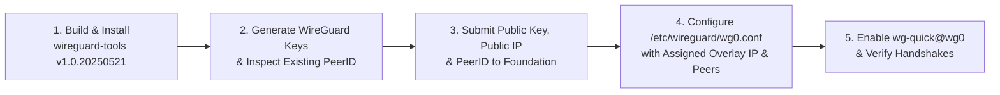

# Midnight Preprod WireGuard Overlay Setup Guide

> **Setup Order — Step 3 of 4** | [← Step 2: FNO Setup](./Validator%20key%20genration.md) · [Overview](./README.md) · **Next:** [Step 4: Running the Validator](./running%20validator.md) →  
> **Document Scope:** Midnight Network — Federated Node Operator (FNO) Trusted Overlay (Preprod)  
> **Source Reference:** `midnightntwrk/midnight-network-ops` (`docs/fno-guides/preprod/wireguard-integration.md`, commit `25d2d3c`, synced `2026-09-15`)

This guide walks you through integrating your validator node into the **Midnight Preprod trusted overlay** using **WireGuard**.

> [!NOTE]
> **New to Midnight? Here is the high-level context:**
> - **What is the trusted overlay?** On Preprod, Midnight validators do not peer over the open internet. Instead, they communicate over an encrypted **WireGuard VPN mesh** (the "trusted overlay") connecting authorized Federated Node Operators (FNOs).
> - **Two separate identities are involved:**
>   1. **WireGuard Keypair (`privatekey` / `publickey`)** — Authenticates your server to the encrypted WireGuard VPN tunnel.
>   2. **Substrate Network Key (`secret_ed25519` / `PeerID`)** — Your `midnight-node` P2P identity *inside* the network (already generated in [Validator key genration.md](./Validator%20key%20genration.md)).

---

## Table of Contents

- [Workflow Overview](#workflow-overview)
- [Before You Begin](#before-you-begin)
- [1. Install WireGuard (`v1.0.20250521`)](#1-install-wireguard-v1020250521)
- [2. Generate Identity Keys](#2-generate-identity-keys)
  - [2.1 WireGuard Keypair (Tunnel Identity)](#21-wireguard-keypair-tunnel-identity)
  - [2.2 Substrate Network Key (Node Identity)](#22-substrate-network-key-node-identity)
- [3. Exchange Details & Configure `wg0.conf`](#3-exchange-details--configure-wg0conf)
  - [3.1 Information to Send to Midnight Foundation](#31-information-to-send-to-midnight-foundation)
  - [3.2 Create the Configuration (`/etc/wireguard/wg0.conf`)](#32-create-the-configuration-etcwireguardwg0conf)
- [4. Enable and Verify the Overlay](#4-enable-and-verify-the-overlay)
- [Key & File Sensitivity Summary](#key--file-sensitivity-summary)

---

## Workflow Overview



---

## Before You Begin

> [!IMPORTANT]
> **Static Public IP Required:** Before you begin, ensure your server has a **static public IP address** configured, and that your firewall/security group allows inbound UDP traffic on the WireGuard listen port you will use in `wg0.conf`.

- **Prerequisite Guide:** Complete [Validator key genration.md](./Validator%20key%20genration.md) first so that `midnight-node` is installed and `$HOME/data/chains/midnight_preprod/network/secret_ed25519` already exists.
- **Target Version:** `wireguard-tools` `v1.0.20250521` (built from source).

---

## 1. Install WireGuard (`v1.0.20250521`)

Midnight requires a specific version of `wireguard-tools` (`v1.0.20250521`). Install the build dependencies and compile it from source using `make` and `gcc`:

```bash
sudo apt update && sudo apt install -y \
    git \
    build-essential \
    pkg-config \
    libelf-dev \
    linux-headers-$(uname -r)

# Define version and create temporary workspace
WIREGUARD_TOOLS_VERSION="v1.0.20250521"
WORKDIR="$(mktemp -d)"

# Clone and build
git clone https://git.zx2c4.com/wireguard-tools "$WORKDIR/wireguard-tools"
cd "$WORKDIR/wireguard-tools"
git checkout "$WIREGUARD_TOOLS_VERSION"
make -C src && sudo make -C src install

# Verify installation
wg --version
```

---

## 2. Generate Identity Keys

You will use two identities: a **new WireGuard keypair** for the encrypted tunnel, and your **existing Substrate network key** for `midnight-node` P2P identification.

### 2.1 WireGuard Keypair (Tunnel Identity)

Generate your WireGuard private and public keys with restricted permissions (`umask 077` ensures only your user can read the private key):

```bash
# Secure newly created files (owner read/write only)
umask 077

# Generate WireGuard keypair
wg genkey | tee privatekey | wg pubkey > publickey
```

- **`privatekey`**: **SECRET** — Stays on your server (used in `/etc/wireguard/wg0.conf`).
- **`publickey`**: **PUBLIC** — Sent to the Midnight Foundation to authorize your node on the overlay.

### 2.2 Substrate Network Key (Node Identity)

> [!WARNING]
> **Do NOT regenerate `secret_ed25519`!** You already generated this key in [Validator key genration.md](./Validator%20key%20genration.md). Regenerating it changes your `PeerID`, which must match what you share with the Midnight Foundation.

Inspect your existing network key to retrieve your node's **Peer ID**:

```bash
NETWORK_DIR="$HOME/data/chains/midnight_preprod/network"
midnight-node key inspect-node-key --file "$NETWORK_DIR/secret_ed25519"
```

---

## 3. Exchange Details & Configure `wg0.conf`

### 3.1 Information to Send to Midnight Foundation

Submit the following details to the Midnight Foundation to be added to the Preprod overlay and receive your overlay IP assignment:

- **Public Key:** Contents of your generated `publickey` file.
- **Public IP:** Your server's static public `IP:Port` (the endpoint peers will connect to).
- **Peer ID:** Your node's network `PeerID` from Section 2.2.

Submit this information using the Foundation's onboarding form:

- **Submission Form:** https://app.notion.com/p/34b4057b9f238006b323d9ccb031b49d?pvs=112

### 3.2 Create the Configuration (`/etc/wireguard/wg0.conf`)

Once you receive your **assigned overlay IP** and **peer details**, create `/etc/wireguard/wg0.conf`.

> [!IMPORTANT]
> **Overlay Configuration Access:** The `wg0.conf` interface and peer blocks (assigned overlay addresses, peer public keys, and endpoints) are maintained in the access-controlled `midnight-network-ops` repository at `configs/wireguard/preprod/wg0.conf`.
>
> To build your local `/etc/wireguard/wg0.conf`:
> 1. Start from `configs/wireguard/preprod/wg0.conf`.
> 2. Fill in the `[Interface]` block with your own `privatekey` and assigned overlay IP address.
> 3. **Delete the single `[Peer]` block that matches your own node**, and leave all other `[Peer]` blocks intact.
>
> If you cannot access the repository, contact the Midnight Foundation.

---

## 4. Enable and Verify the Overlay

Start the WireGuard tunnel service, enable it on boot, and verify that handshakes and traffic are flowing:

```bash
# Start and enable the tunnel service
sudo systemctl enable --now wg-quick@wg0

# Verify recent handshakes and data transfer
sudo wg show
```

**Connectivity Checklist:**

- **Latest Handshake:** Should be recent (e.g., `latest handshake: 15 seconds ago`).
- **Transfer:** `received` data must be greater than `0 B`.
- **Ping Test:** Run `ping <validator_overlay_ip>` (using another peer's overlay IP from `wg0.conf`) to confirm the internal overlay route is active.

---

## Key & File Sensitivity Summary

| File | Contains | Sensitivity | Action |
| :--- | :--- | :--- | :--- |
| `privatekey` | WireGuard tunnel private key | **SECRET** | Keep on server, `chmod 600`, never share |
| `~/data/chains/midnight_preprod/network/secret_ed25519` | Substrate P2P private key | **SECRET** | Keep on server, do **not** regenerate |
| `/etc/wireguard/wg0.conf` | Tunnel config (contains `privatekey`) | **SECRET** | Restrict permissions (`chmod 600`), never commit to Git |
| `publickey` | WireGuard tunnel public key | **PUBLIC** | Send to Midnight Foundation via onboarding form |

---

**Navigation:** [← Step 2: FNO Setup](./Validator%20key%20genration.md) · [Overview](./README.md) · **Next:** [Step 4: Running the Validator →](./running%20validator.md)
